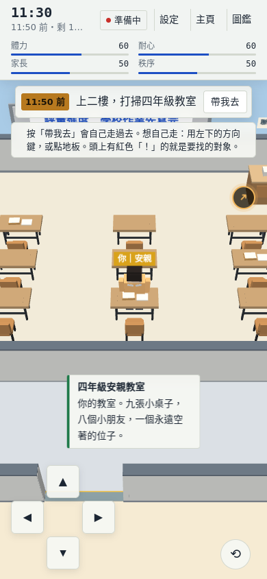
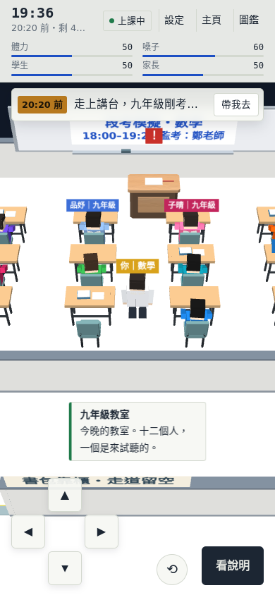
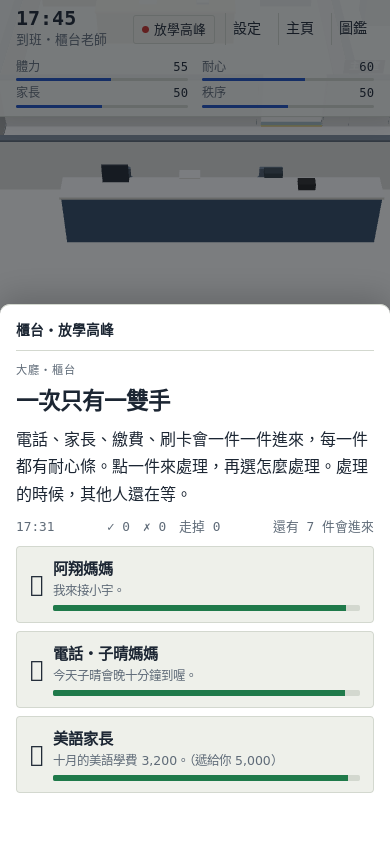
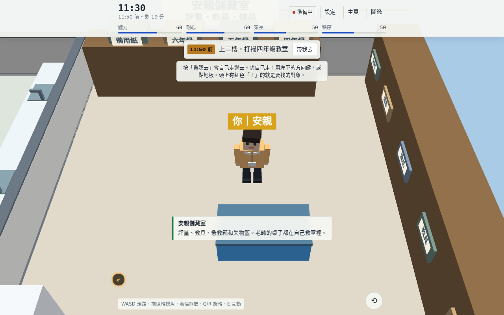

# 國小＋國中版：美術第二輪

本輪以 `redesign-elem-jh` 的 `afa3e22` 製作及驗證，交付前接入 `d9713c3` 的 README 與分享卡下載更新。分支 `codex/redesign-art-pass2`，合併目標為 `redesign-elem-jh`；尚未合併 main 或發布正式版。

## 完成內容

- `assets/og.png`：1200×630，新版四年級安親與九年級教室的實際 WebGL 畫面，列出五個角色及放學高峰。
- `src/art.js`：二樓各年級教室提醒欄、老師桌前板及改評量工具；安親儲藏室分類箱與教具箱收邊；洗手台水龍頭；閱讀角書本；點心桌及書包櫃細節。
- 三樓增加複習提醒、講桌卷子、課輔室教材、講師休息室與班導工作區識別、置物櫃格線。國中部格局、家具位置、座位和命名地點未變動。
- 安親白板托盤與板擦依白板左移位置對齊；移除儲藏室內沿用舊辦公室假設的浮空書本。學生桌教材改由 `seatsOf()` 回推桌心，與 `furnishRoom()` 同方向。
- `tools/render-og.cjs` 可從除錯版實際場景重新產生縮圖；`index.html` 由 `build.py` 重建。

## 驗證

使用 Chromium、真正的 Three.js r128／WebGL（SwiftShader）與行動版 viewport。這是瀏覽器模擬驗證，**不是實體 iPhone／Android 試玩**，也不代表真機 GPU 效能或劇情節奏已獲玩家確認。

| 檢查 | 結果 |
| --- | --- |
| 安親老師第一天，390×844 | 到達「家長最放心的安親老師」，頁面錯誤 0 |
| 安親老師第二天，390×844 | 到達「把每個人好好交出去」，頁面錯誤 0 |
| 跑堂數學老師第二天，390×844 | 到達「兩個班都記得的老師」，八年級暖身與九年級模擬卷檢討可完成，頁面錯誤 0 |
| 櫃台第一天，390×844 | 到達「櫃台的定海神針」，放學高峰處理 10 件、漏掉 0 件，頁面錯誤 0 |
| 畫面檢查 | 390×844、360×640、1280×800，無頁面錯誤；放學高峰任務按鈕高度約 77px，未超出畫面寬度 |
| 接入 `d9713c3` 後的觸控模擬 | 使用觸控事件點選 10 個高峰任務與 10 個回覆，全部可點；最小按鈕高度約 47px，沒有超出 390px 畫面寬度，頁面錯誤 0 |
| `tests/consistency.js`、`tests/timeline.js` | 通過 |
| `tests/navigation.js` | 45 個地點、71 個座位可到達；國中人流 22/22、週三國小人流 18/18 到座；玩家 1F→3F 成功 |
| 美術前後碰撞比較 | 265 個碰撞區逐項完全一致 |
| 語法、建置及差異檢查 | `node --check`、`python3 build.py`、`git diff --check` 通過 |

完整流程沿用既有 `tests/play2.js` 的操作器，改用 390×844 行動 viewport 與真正的 Three.js；空檔由既有時鐘測試介面推進，不等待遊戲內數小時，也不直接跳過主線步驟。選項由測試操作器選取，不能據此判定劇情自然或時間壓力適中。

## 畫面

## 交接

本輪不修改 README、分享卡下載或舊存檔政策。實體手機仍需確認旋轉視角、按鈕觸控、樓梯／電梯換層及放學高峰的閱讀壓力。舊存檔處理與正式合併由 Claude 依使用者決定執行。
